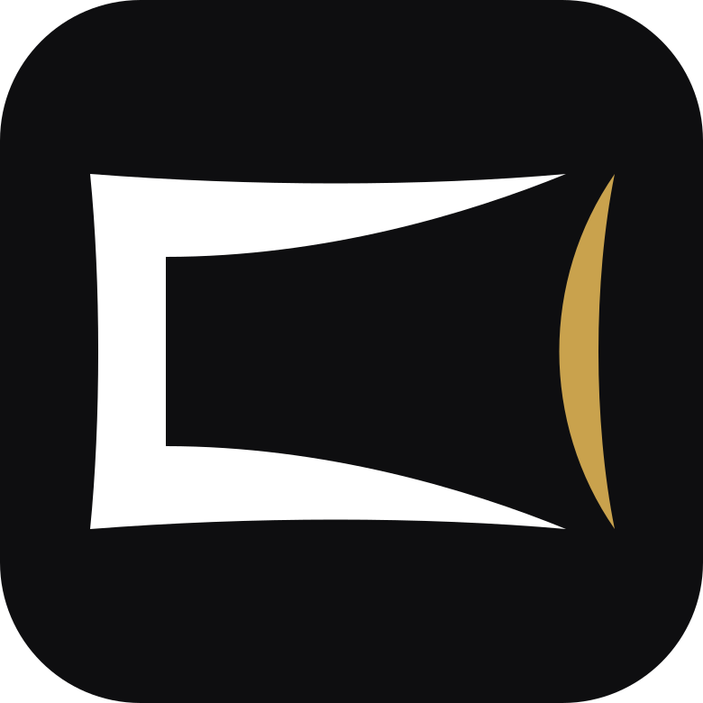

  

<h1 align="center">Zaviya</h1>

<strong>for ARM handhelds</strong>

  Based on SteamOS for ARM, built for handhelds and tablets: Game Mode, the KDE desktop, PC games through FEX and Proton, and Android apps.

Formerly known as Unofficial SteamOS ARM Port.

  
  
  
  
  
  
  

  <a href="https://zaviyaos.github.io/getting-started/install/"><strong>Install it</strong></a>
  ·
  <a href="https://zaviyaos.github.io/devices/">Supported devices</a>
  ·
  <a href="https://zaviyaos.github.io/downloads/">Downloads</a>
  ·
  <a href="https://zaviyaos.github.io/help/known-issues/">Known issues</a>

> [!WARNING]
> This is an unofficial community project.
> Installing it means flashing the OpenABL bootloader, and getting that
> wrong can leave your device unable to boot or lose your data. Back up first
> and follow the [install guide](https://zaviyaos.github.io/getting-started/install/)
> step by step.

## About

Zaviya is based on SteamOS for ARM, which is made for a VR headset. Out of the box,
much of it gets in the way on a handheld: services that keep crashing, the UI
stuck on the slow cores, the GPU not clocking up, and standby that drains the
battery. Zaviya turns off what a handheld doesn't need and fixes the rest. The
details are in [HOW-IT-WORKS.md](docs/HOW-IT-WORKS.md).

Features:

- Game Mode and Desktop Mode, with the controller showing up as a Steam Deck pad
- x86 PC games through FEX and ARM64 Proton, plus Epic, GOG and Amazon through Heroic
- Android apps with the Play Store, and Restart into Android from Zaviya Control
- Updates from Settings > System, no reflashing
- Install to internal storage next to Android, or keep it on a microSD card
- Game Mode on an external monitor or dock, sound included
- Lossless Scaling frame gen (lsfg-vk 2.0 and Classic 1.x), Decky and the performance overlay
- Steam Remote Play with hardware decoding, plus optional PyroWave
- Zaviya Loadout, which installs emulators and apps picked for your SoC
- Sleep that lasts, quiet fan curves, and a clean power off before the battery runs flat
- A dashboard with themes on the bottom screen of the AYN Thor and AYANEO Pocket DS

## Quick start

1. Flash the OpenABL bootloader for your SoC by following the [ABL guide](https://zaviyaos.github.io/getting-started/abl/). Older OpenABL versions also work. Back up the stock ABL first.
2. Download the image for your SoC from [Releases](https://github.com/hashtagbasit/Zaviya/releases/latest), open the `.001` part with 7-Zip and flash the `.img` inside to a microSD card (32 GB+) with balenaEtcher or Rufus.
3. Boot the card from the ABL menu and pick your device. First boot takes a couple of minutes.

Existing installs update from Settings > System > Check for updates.

## Devices

### Handhelds

| SoC | Devices | Status |
|---|---|---|
| Snapdragon 8 Elite | AYN Odin 3, KONKR Pocket FIT Elite | Stable |
| Snapdragon 8 Gen 3 | KONKR Pocket FIT, AYANEO Pocket S2 / S2 Pro | Stable |
| Snapdragon 8 Gen 2 | AYN Odin 2 / Mini / Portal / Thor, AYANEO Pocket ACE / DMG / DS / EVO / S 1K / S 2K, Retroid Pocket 6 / Nova | Stable |
| Snapdragon 865 | Retroid Pocket 5 / Flip 2 / Mini / Mini V2, AYN Thor Lite, MANGMI Air Y Pro / Pocket Max, AYANEO Pocket MICRO 2 | Beta |

There is one image per SoC. The device is selected in the ABL menu and the
system configures itself. Development happens on the KONKR Pocket FIT and the
community tests the other devices, so
[reports from other devices](https://github.com/hashtagbasit/Zaviya/issues) are welcome.

### Phones & tablets

| Device | SoC | Status |
|---|---|---|
| Lenovo Legion Y700 Gen 3 (TB321FU) | Snapdragon 8 Gen 3 | In testing |
| Lenovo Legion Y700 Gen 4 (TB322FC) | Snapdragon 8 Elite | In testing |
| Lenovo Legion Y700 Gen 5 (TB323FU) | Snapdragon 8 Elite Gen 5 | In testing |
| REDMAGIC 6 (NX669J) | Snapdragon 888 | Build it yourself ([guide](docs/redmagic6.md)) |

The Gen 3 and Gen 4 install to internal storage next to Android, and the
Gen 4 can also run from a microSD card. The Gen 5 runs from a microSD card, is
switched on from Android, and is in early testing. Tablet builds are published
on [Discord](https://discord.gg/e2Cn85uQh9) first. See the
[Lenovo page](https://zaviyaos.github.io/devices/lenovo/) for details.

## Documentation

The full documentation is on the [website](https://zaviyaos.github.io/).

| Topic | Guide |
|---|---|
| Install | [Flash to a microSD card](https://zaviyaos.github.io/getting-started/install/) |
| Device support | [Supported devices](https://zaviyaos.github.io/devices/) |
| Internal storage install | [Internal storage](https://zaviyaos.github.io/getting-started/internal-storage/) |
| Update | [Updates](https://zaviyaos.github.io/using/updates/) |
| Get help | [FAQ](https://zaviyaos.github.io/help/faq/) · [Troubleshooting](https://zaviyaos.github.io/help/troubleshooting/) |
| Report a bug | [GitHub issues](https://github.com/hashtagbasit/Zaviya/issues) |

## Building

The images are built from this repository on an ARM64 Linux machine. See
[docs/building.md](docs/building.md). Issues and pull requests are welcome.
Installation help is available on [Discord](https://discord.gg/e2Cn85uQh9).

## Supporting the project

  
  

Donations go toward buying devices for development and testing.

Device loans for long-term development are the fastest route to new device
support. Contact the maintainer on [Discord](https://discord.gg/e2Cn85uQh9).

## Credits

The kernels and device support build on the work of many people, and fixes are
shared with other ARM handheld projects. Thanks to every code contributor, and
to the Discord testers who send logs from their devices. The full list of
projects and people is in [CREDITS.md](CREDITS.md).

## License

The project's scripts and overlays are GPL-2.0. Everything in `external-and-mods/`
keeps its own license. See [LICENSE](LICENSE).

SteamOS and Steam are trademarks of their owner. This project isn't affiliated with or endorsed by them.
